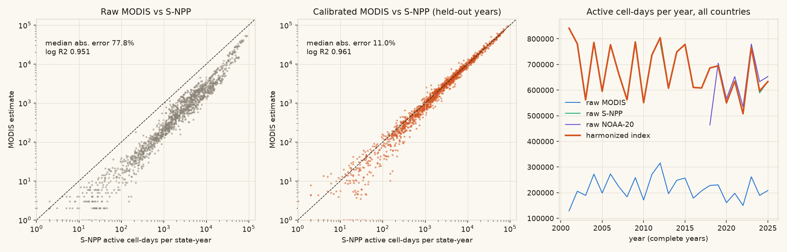
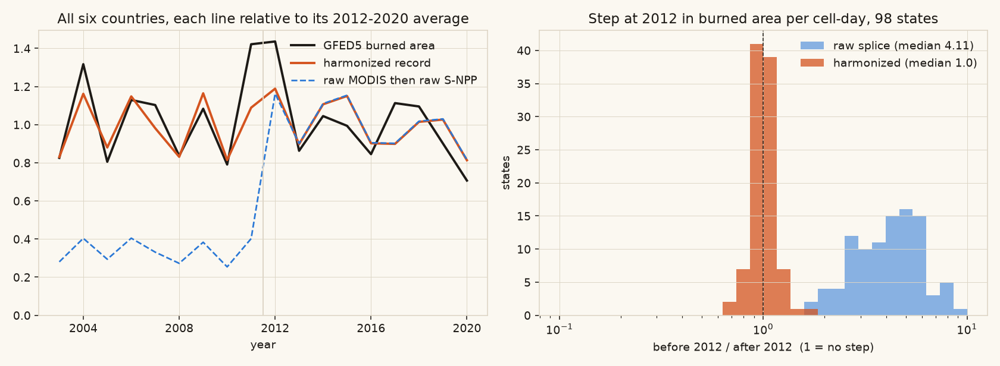

# BurnCalendar

One fire record from MODIS and VIIRS, for India, Bangladesh, Myanmar, Nepal, Australia and Indonesia, from November 2000 to today.

Built for the NASA Space Apps Challenge 2026, challenge **"Harmonization of MODIS and VIIRS Hot Spots"**.


## What it does

- **Harmonized record.** MODIS (Terra, Aqua) and VIIRS (S-NPP, NOAA-20, NOAA-21) active-fire detections on one grid, one daily time step and one scale.
- **Burning activity calendar.** A month × year heatmap for any country, state or drawn area, plus a day × year calendar for countries and states.
- **Early warning with measured skill.** The last 30 days against the same 30 days in every year since 2003, as a map and a ranked table, with a backtest showing how often the flag was right.
- **Uncertainty.** Every estimated value carries a likely range from held-out years.
- **Area of interest.** Click a state, draw a box, or type `lat, lon` or `W, S, E, N`.
- **Downloads.** Monthly series as CSV, the latest hotspots in the area as CSV, and the calendar as an SVG image.

## How the harmonization works

1. **One schema.** Every detection is read into one table with a sensor label. Presumed vegetation fires are kept (`type = 0`). Low-confidence detections are dropped (MODIS confidence < 30, VIIRS `low`).
2. **Static-source mask.** Near-real-time rows carry no `type`, so industrial heat sources would leak into the newest months. A grid cell is masked for those rows if the archive saw at least 5 non-vegetation detections there and they make up at least a quarter of its typed detections (2,151 cells).
3. **Active cell-days.** Detections are snapped to a fixed 0.05° grid. The unit of activity is the active cell-day: a cell with at least one detection on a UTC day. It removes duplicates across satellites by construction and is much less sensitive to pixel size than raw counts. For all six countries (UTC+5 to UTC+11) a UTC day groups the afternoon overpass with the following night overpass.
4. **One scale.** S-NPP active cell-days are the reference. For each state and calendar month, a factor `k = Σ S-NPP / Σ other sensor` is fitted on the overlap years and shrunk toward the country-month and all-area-month values when counts are small (prior weight 100 cell-days).
5. **One record.**

   | Period | Source | Factor |
   |---|---|---|
   | Nov 2000 – 3 Jul 2002 | Terra alone | Terra → Terra+Aqua (fitted 2003–2007) × MODIS → S-NPP |
   | 4 Jul 2002 – 19 Jan 2012 | Terra + Aqua | MODIS → S-NPP (fitted 2012–2025) |
   | 20 Jan 2012 – 2025 | S-NPP | 1 (reference). Months where S-NPP itself was down are filled from NOAA-20 |
   | 2026 onward | NOAA-20 and NOAA-21, averaged | NOAA-20 → S-NPP (fitted Apr 2018 – 2025) and NOAA-21 → S-NPP (fitted Mar 2023 – 2025) |

   S-NPP's near-real-time feed stops on 2 November 2026, so the record hands over at the start of 2026 to the mean of calibrated NOAA-20 and calibrated NOAA-21. The two pass at different times, so the mean is steadier than either alone. If the two disagree by more than the sensor-health band in a month, that month uses the one that sees more; this has not happened so far.

The grid is 0.05° for counting. The web app sums cells into 0.25° tiles for the map and for drawn areas.

## Validation

Factors were fitted on even years and tested on odd years, and the reverse, for 2012–2025. Each point is one state in one year (1,560 state-years).

| MODIS estimate of S-NPP | Median absolute error | Total ratio |
|---|---|---|
| Raw MODIS | 77.8% | 0.329 |
| One factor for everywhere | 37.0% | 1.000 |
| **State and month factors (this project)** | **11.0%** | **1.001** |

- At state-month level the calibrated median error is 15.6% (16,595 state-months).
- The Terra-alone chain, tested on 2008–2011 (not used for its fit), has a median error of 13.0%.
- NOAA-20 calibrated to S-NPP has a median error of 3.5% on held-out years; NOAA-21 has 4.5% (2023–2025 only, 335 state-years). On those same 335 state-years the mean of the two has 3.4%, against 3.7% for NOAA-20 alone. The gain is small but it also removes the dependence on a single satellite.
- **Would viewing angle or day and night help?** Published methods correct MODIS for viewing angle (its pixels grow towards the swath edge), and day and night passes detect differently. We added to the factors, in a held-out experiment, the mean MODIS scan size of each state-month, the share of night detections, and both. State-year error went from 11.0% to 10.8%, 10.9% and 10.9%; state-month from 15.6% to 15.5%, 15.5% and 15.3%. We did not adopt them: the gains are within noise, and per-state, per-calendar-month factors already absorb most of the average effect. Note the day and night test used the night share as a covariate. It did not split the record into separate day and night series, which would change the unit.
- **Single map tiles are much less certain than states.** At the level of one 0.25° tile in one year, the held-out median error is about 23%. Drawn areas are sums of tiles, so a small box carries an error of that order.
- **Would fire type help?** The literature says the sensors disagree most over cropland, and our data agrees: S-NPP sees 4.0 times as many cell-days as MODIS on cropland tiles, against 2.8 elsewhere (fire type taken from GFED5). Adding fire type to the factors, in a separate held-out experiment, lowered the state-year error by about one point (11.9% to 11.0% in that setup) and barely moved the tile-level error (23.5% to 23.2%). We did not adopt it: the gain is small, and it would make GFED5 part of the model as well as the check.
- Monthly MODIS and S-NPP activity over the whole area correlate at r = 0.932; S-NPP sees 3.04 times as many active cell-days.
- The record month for New South Wales comes out as December 2019, 24 times the usual December: the 2019–20 bushfire season, recovered without being told about it.



## A consistency check against burned area

GFED5 (Chen et al. 2023) maps burn scars from MODIS for 2001–2020, with no change of sensor in 2012. Burned area per active cell-day should be the same before and after 2012; a step would mean the factors were applied wrongly. Across 98 states, 2003–2020:

| Step at 2012 (1 = none) | Median | Middle half of states |
|---|---|---|
| Harmonized record | 1.00 | 0.94 to 1.10 |
| Raw MODIS on both sides | 1.00 | 0.93 to 1.05 |
| Raw MODIS, then raw S-NPP | 4.11 | 3.04 to 5.31 |



**What this does not show.** Raw MODIS alone passes the same test: the factors were fitted on the years after 2012, so they cancel out of it. The check confirms the factors were applied correctly (right era, right direction, Terra chain). It cannot confirm they hold for 2003–2011, when VIIRS did not exist. The evidence for the factors is the held-out test above.

One part is a real cross-sensor check: in 2012–2020, S-NPP's high and low years match burned area with a median rank correlation of 0.92. GFED5 also uses MODIS active fires for its small-fire correction.

## What the record shows

- **Trends.** Join the raw records end to end and fire appears to rise in 74 of 99 states over 2003–2025. On one scale it rises in 18, falls in 25 and shows no clear trend in 56. In 57 states the apparent rise was the sensor change.
- **Season timing.** The main season has moved later in 6 states and earlier in 5 (of 96 with enough fire). Punjab's October season is 7.3 days later per decade, about 16 days later than in 2003–2007; neighbouring Haryana shows the same direction.
- Both findings hold on a single sensor. On MODIS alone (2003–2025) the trend verdict matches the harmonized record in 74 of 85 states and never reverses, and Punjab is 8.2 days later per decade. On S-NPP alone (2012–2025) Punjab is 5.1 days later per decade.
- Trends are Theil–Sen slopes with a Mann–Kendall test at 5%. With 99 tests, about five would pass by chance. A trend that crosses 2012 carries the uncertainty of the estimated years. The raw splice illustrates the problem; it is not a method anyone should use.

## Sensor health

Each month, one sensor's count is compared with what the other predicts for it after calibration (1.0 = they agree as in the fit years). A month outside 0.75–1.33 is flagged.

- MODIS against VIIRS: August 2020 (0.54) and April 2022 (0.67).
- S-NPP against NOAA-20: July 2024 (0.63), and November 2026 (0.09), when the S-NPP feed stops.
- NOAA-21 against NOAA-20 (from March 2023): no month flagged; 2026 months range from 0.94 to 1.13.
- The record acts on the flag: July 2024, when S-NPP was the low one, is filled from calibrated NOAA-20 (24,111 cell-days over the whole area, against 15,114 from S-NPP).
- S-NPP ran 6–16% low in several months of 2026 before stopping, which is inside the band and was not flagged.

## How good is the early warning?

The rule was replayed on every week of 2003–2025 in all 112 states (133,952 state-weeks). Thresholds are leave-one-year-out, so a year never sets its own bar. "Severe" means the following 30 days are at or above the 90th percentile for those dates.

| Severe period starts | Flag was right | Severe periods caught | Against chance |
|---|---|---|---|
| The next day | 33% | 33% | 3.7× |
| 2 weeks later | 28% | 28% | 3.1× |
| 4 weeks later | 24% | 24% | 2.7× |

- An ordinary week is followed by a severe period 9% of the time.
- The lower "above normal" level (75th percentile) catches 51% of severe periods and is right 27% of the time.
- Replayed on 2019, the rule first fired for New South Wales on 29 October, 64 days before the peak of the 2019–20 season.
- This is a persistence signal, not a weather forecast. It misses about two severe periods in three.
- Thresholds use the other years, including later ones, so this is not a true real-time test. Neighbouring weeks overlap, so there are far fewer independent cases than state-weeks, and no confidence interval is given.

## Uncertainty on estimated years

Every value before 2012 and from 2026 is an estimate on the S-NPP scale. The app shows a range next to each one: the 80% range of truth ÷ estimate on held-out years, per state (thin states borrow their country's range).

| Period | Whole area, by month | Whole area, by year |
|---|---|---|
| Terra alone (2000–2002) | 0.65 to 2.12 | 0.76 to 1.40 |
| Terra + Aqua (2002–2011) | 0.91 to 1.11 | 0.96 to 1.08 |
| NOAA-20 and NOAA-21 (2026) | 0.97 to 1.05 (the NOAA-20 range, kept as the wider one) | |

Single states are wider: New South Wales by month is 0.81 to 1.62.

## Related work

This project did not start from a literature review, and the core idea is not new. What follows is from the abstracts of the papers below, read after the method was built.

- **Region-specific scaling is how the experts do it.** GFED5NRT (Chen et al. 2026) keeps the Global Fire Emissions Database going as MODIS drifts and retires by converting VIIRS active-fire counts with lookup tables that are specific to biome and region, so the result is consistent with the MODIS-era GFED5 series. Our per-state, per-month factors belong to the same family. We scale by state and calendar month, not by biome, and that is a simplification.
- **The sensors disagree differently by land cover.** Fu et al. (2020) compared near-simultaneous Aqua MODIS and S-NPP VIIRS 375 m detections in Northeast Asia for 2012–2017. MODIS missed 65% of VIIRS fire pixels in forests and 83% in croplands and grasslands; VIIRS missed 35% and 53% of MODIS pixels. This is why one factor for everywhere performs badly in our tests (37% error against 11%), and it is a reason to expect our factors to shift if land use in a state changes.
- **Other routes exist.** Zheng et al. (2026) fuse fire radiative power from MYD14 and VNP14IMG after correcting MODIS for viewing angle and VIIRS for cloud. We harmonize counts of active cells, not radiative power. We tested a viewing-angle covariate and did not keep it (see Validation).
- **The products themselves.** Giglio et al. (2016) describe the MODIS Collection 6 active-fire algorithm; Schroeder et al. (2014) describe the VIIRS 375 m product. Chen et al. (2023) describe GFED5 burned area, used here as a consistency check.

**What this project adds** is the application and the checking around it, not the scaling idea: a state-level burning calendar across the sensor change for six countries, held-out validation, a likely range on every estimated value, a backtested early warning, and an open monthly dataset.

### References
- Chen, Y., et al. (2026). Tracking recent extremes and interannual variability of global fire emissions using a near-real-time extension to the Global Fire Emissions Database. *Earth System Science Data*, 18, 7535–7555. https://doi.org/10.5194/essd-18-7535-2026
- Chen, Y., et al. (2023). Multi-decadal trends and variability in burned area from the fifth version of the Global Fire Emissions Database (GFED5). *Earth System Science Data*, 15, 5227–5259. https://doi.org/10.5194/essd-15-5227-2023. Data: https://doi.org/10.5281/zenodo.7668423
- Fu, Y., Li, R., Wang, X., Bergeron, Y., Valeria, O., Chavardès, R. D., Wang, Y., & Hu, J. (2020). Fire detection and fire radiative power in forests and low-biomass lands in Northeast Asia: MODIS versus VIIRS fire products. *Remote Sensing*, 12(18), 2870. https://doi.org/10.3390/rs12182870
- Zheng, Y., Ding, K., Xue, L., Wang, Z., Jiao, G., Zhu, Y., Zhang, J., & Ren, Q. (2026). Fire radiative power correction and spatiotemporal fusion based on MYD14 and VNP14IMG. *Remote Sensing*, 18(10), 1650. https://doi.org/10.3390/rs18101650
- Giglio, L., Schroeder, W., & Justice, C. O. (2016). The collection 6 MODIS active fire detection algorithm and fire products. *Remote Sensing of Environment*, 178, 31–41.
- Schroeder, W., Oliva, P., Giglio, L., & Csiszar, I. A. (2014). The new VIIRS 375 m active fire detection data product: algorithm description and initial assessment. *Remote Sensing of Environment*, 143, 85–96.

## Limits

- **No biome or viewing-angle correction.** Published methods scale by biome as well as region, and correct MODIS for viewing angle. We tested fire type, viewing angle and night share as extra inputs; none improved held-out error by more than about a point, so the factors stay per state and month.
- **The main assumption:** the relationship between MODIS and VIIRS seen in 2012–2025 is assumed to hold for 2003–2011. Fire sizes, farming practice and the ageing of MODIS could each break that, and nothing can test it directly. The likely ranges reflect 2012–2025 only, so they are probably too narrow for early years.
- MODIS misses small fires that VIIRS sees. A factor restores the average for a state and month, not individual fires, so pre-2012 values are estimates.
- 2000–2002 (Terra alone) is the least certain part. Medians and percentiles use 2003 onward.
- The newest months use near-real-time data, which NASA later reprocesses. Early-warning results are provisional.
- NOAA-21 has only three overlap years with S-NPP (2023–2025), so its factors rest on less data than NOAA-20's.
- Grid cells are 0.05° in latitude and longitude, so they cover less ground further from the equator (about 28% less in southern Australia). Factors are fitted per state, so this does not bias a state against itself, but cell-days are not comparable between far-apart latitudes.
- The build expects the 30-day warning window to sit inside one calendar year, so it stops if run between 1 and 29 January.
- Drawn areas use 0.25° tiles and include a tile when its centre is inside the box.
- State boundaries come from Natural Earth (admin-1, v5). They are dated in places (Bangladesh has 7 divisions, Nepal uses the old zones, Indonesia has 33 provinces) and are not authoritative.

## Numbers

- 68,321,281 detections in the record (82,174,258 read; the rest fall outside the six countries or are filtered out).
- 17,132,649 active cell-days, 1 November 2000 to 14 November 2026.
- 112 states, provinces and divisions, 20,242 map tiles, 313 months.

## Reproduce

```bash
python3 -m venv .venv && .venv/bin/pip install -r pipeline/requirements.txt
.venv/bin/python -I pipeline/download.py data/raw Bangladesh Nepal Myanmar India Indonesia Australia   # ~5 GB, no key needed
echo "FIRMS_MAP_KEY=your_key" > .env
.venv/bin/python -I pipeline/download_api.py .env data/raw_api                     # current year, South Asia box
.venv/bin/python -I pipeline/download_api.py .env data/raw_api oc 94,-45,155,7     # current year, Indonesia and Australia box (~810 MB in all)
# NOAA-21 has no yearly archive, so its 2023-2025 record comes from the API too (~600 MB, about 10 minutes)
.venv/bin/python -I pipeline/download_api.py .env data/raw_api --since 2023 --sources VIIRS_NOAA21_SP
.venv/bin/python -I pipeline/download_api.py .env data/raw_api oc 94,-45,155,7 --since 2023 --sources VIIRS_NOAA21_SP
# Natural Earth admin-1 shapefile unzipped into data/geo/
.venv/bin/python -I pipeline/harmonize.py data/raw data/raw_api data/geo data/out
.venv/bin/python -I pipeline/build.py data/out data/raw_api web/public/data docs
cd web && npm install && npm run dev

# tests
.venv/bin/python -I pipeline/test_pipeline.py   # calibration fit, tile format, warning backtest
node --test web/lib/data.test.ts
```

The burned-area check needs GFED5 (`BA.zip`, 265 MB, from Zenodo record 7668424) unzipped into `data/gfed5/`:

```bash
.venv/bin/pip install netCDF4
.venv/bin/python -I pipeline/validate_ba.py data/out data/gfed5 web/public/data docs
```

The harmonized monthly record is published with the site at `/data/burncalendar_monthly.csv`; see `docs/DATA_CARD.md`.

The web app is static: everything it needs is precomputed into `web/public/data` (about 17 MB).

## Data and tools

- **NASA data:** FIRMS active fire products — MODIS Collection 6.1 (MCD14ML standard, MCD14DL near-real-time) and VIIRS 375 m for S-NPP, NOAA-20 and NOAA-21 (standard and near-real-time), from the FIRMS country archive and the FIRMS area API.
- **Other data:** GFED5 burned area (Chen et al. 2023, Zenodo 10.5281/zenodo.7668423, CC BY 4.0), used only for validation; Natural Earth admin-1 boundaries; CARTO Dark Matter basemap with OpenStreetMap data.
- **Pipeline:** Python, Polars, DuckDB, pandas, NumPy, GeoPandas, Shapely, Matplotlib, Requests, netCDF4.
- **Web:** Next.js, React, TypeScript, MapLibre GL JS.

## Use of AI

Code, documentation and the project text were written with Claude (Anthropic), used as an AI coding assistant, and reviewed by the team. No AI-generated images or video are used. This is not a NASA product and uses no NASA branding.

## Licence

Code: MIT (see `LICENSE`). The harmonized record in `web/public/data`: CC BY 4.0 (see `docs/DATA_CARD.md`). Sound effects in `demo/sfx`: CC0, from SFX Kit by Wyzowl (see `demo/sfx/LICENSE`).

Source code: https://github.com/planc1k/burncalendar
