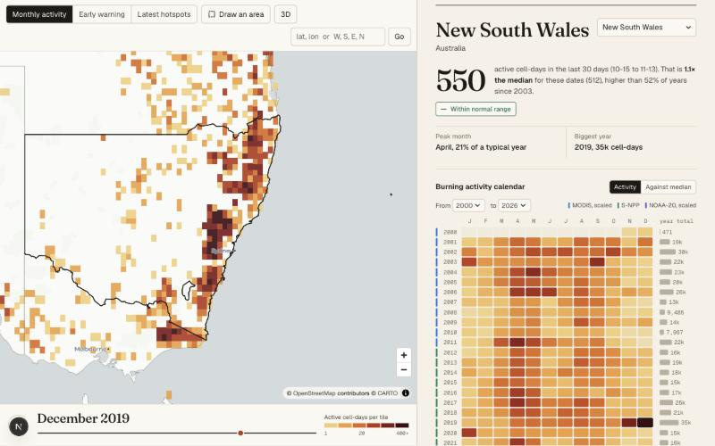

# BurnCalendar

One fire record from MODIS and VIIRS, for India, Bangladesh, Myanmar, Nepal, Australia and Indonesia, from November 2000 to today.

Built for the NASA Space Apps Challenge 2026, challenge **"Harmonization of MODIS and VIIRS Hot Spots"**.



## What it does

- **Harmonized record.** MODIS (Terra, Aqua) and VIIRS (S-NPP, NOAA-20) active-fire detections on one grid, one daily time step and one scale.
- **Burning activity calendar.** A month × year heatmap for any country, state or drawn area, plus a day × year calendar for countries and states.
- **Early warning with measured skill.** The last 30 days against the same 30 days in every year since 2003, as a map and a ranked table, with a backtest showing how often the flag was right.
- **Uncertainty.** Every estimated value carries a likely range from held-out years.
- **Area of interest.** Click a state, draw a box, or type `lat, lon` or `W, S, E, N`.
- **Downloads.** Monthly series as CSV, the latest hotspots in the area as CSV, and the calendar as an SVG image.

## How the harmonization works

1. **One schema.** Every detection is read into one table with a sensor label. Presumed vegetation fires are kept (`type = 0`). Low-confidence detections are dropped (MODIS confidence < 30, VIIRS `low`).
2. **Static-source mask.** Near-real-time rows carry no `type`, so industrial heat sources would leak into the newest months. A grid cell is masked for those rows if the archive saw at least 5 non-vegetation detections there and they make up at least a quarter of its typed detections (2,151 cells).
3. **Active cell-days.** Detections are snapped to a fixed 0.05° grid. The unit of activity is the active cell-day: a cell with at least one detection on a UTC day. It removes duplicates across satellites by construction and is much less sensitive to pixel size than raw counts. For all six countries (UTC+5 to UTC+11) a UTC day groups the afternoon overpass with the following night overpass.
4. **One scale.** S-NPP active cell-days are the reference. For each state and calendar month, a factor `k = Σ S-NPP / Σ other sensor` is fitted on the overlap years and shrunk toward the country-month and all-area-month values when counts are small (prior weight 100 cell-days).
5. **One record.**

   | Period | Source | Factor |
   |---|---|---|
   | Nov 2000 – 3 Jul 2002 | Terra alone | Terra → Terra+Aqua (fitted 2003–2007) × MODIS → S-NPP |
   | 4 Jul 2002 – 19 Jan 2012 | Terra + Aqua | MODIS → S-NPP (fitted 2012–2025) |
   | 20 Jan 2012 – 2025 | S-NPP | 1 (reference) |
   | 2026 onward | NOAA-20 | NOAA-20 → S-NPP (fitted Apr 2018 – 2025) |

   S-NPP's near-real-time feed thins during 2026 and stops on 2 November 2026, so the record hands over to NOAA-20 at the start of 2026.

The grid is 0.05° for counting. The web app sums cells into 0.25° tiles for the map and for drawn areas.

## Validation

Factors were fitted on even years and tested on odd years, and the reverse, for 2012–2025. Each point is one state in one year (1,560 state-years).

| MODIS estimate of S-NPP | Median absolute error | Total ratio |
|---|---|---|
| Raw MODIS | 77.8% | 0.329 |
| One factor for everywhere | 37.0% | 1.000 |
| **State and month factors (this project)** | **11.0%** | **1.001** |

- At state-month level the calibrated median error is 15.6% (16,595 state-months).
- The Terra-alone chain, tested on 2008–2011 (not used for its fit), has a median error of 13.0%.
- NOAA-20 calibrated to S-NPP has a median error of 3.5% on held-out years.
- Monthly MODIS and S-NPP activity over the whole area correlate at r = 0.932; S-NPP sees 3.04 times as many active cell-days.
- The record month for New South Wales comes out as December 2019, 24 times the usual December: the 2019–20 bushfire season, recovered without being told about it.


## Checked against burned area

GFED5 (Chen et al. 2023) maps burn scars from MODIS surface reflectance for 2001–2020, with no change of sensor in 2012. If the harmonization is right, a state should show the same burned area per active cell-day before and after 2012. Across 98 states, 2003–2020:

| | Harmonized | Raw MODIS then raw S-NPP |
|---|---|---|
| Step at 2012 (1 = none), median | 1.00 | 4.11 |
| Middle half of states | 0.94 to 1.10 | 3.04 to 5.31 |
| States with a step under 25% | 93% | 0% |
| Do high and low years match? (median rank correlation) | 0.92 | 0.51 |


Burned area and active-fire counts measure different things, so only the comparison across 2012 is meaningful. GFED5 also uses MODIS active fires for its small-fire correction, so it is not fully independent of our MODIS years.

## What the record shows

- **Trends.** Join the raw records end to end and fire appears to rise in 74 of 99 states over 2003–2025. On one scale it rises in 18, falls in 25 and shows no clear trend in 56. In 57 states the apparent rise was the sensor change.
- **Season timing.** The main season has moved later in 6 states and earlier in 5 (of 96 with enough fire). Punjab's October season is 7.3 days later per decade, about 16 days later than in 2003–2007; neighbouring Haryana shows the same direction.
- Trends are Theil–Sen slopes with a Mann–Kendall test at 5%. A trend that crosses 2012 carries the uncertainty of the estimated years.

## Sensor health

Each month, one sensor's count is compared with what the other predicts for it after calibration (1.0 = they agree as in the fit years). A month outside 0.75–1.33 is flagged.

- MODIS against VIIRS: August 2020 (0.54) and April 2022 (0.67). July 2024 reads 1.49 because S-NPP was low that month.
- S-NPP against NOAA-20: July 2024 (0.63), and November 2026 (0.09), when the S-NPP feed stops.
- S-NPP ran 6–16% low in several months of 2026 before stopping, which is inside the band and was not flagged.

## How good is the early warning?

The rule was replayed on every week of 2003–2025 in all 112 states (133,952 state-weeks). Thresholds are leave-one-year-out, so a year never sets its own bar. "Severe" means the following 30 days are at or above the 90th percentile for those dates.

| Severe period starts | Flag was right | Severe periods caught | Against chance |
|---|---|---|---|
| The next day | 34% | 33% | 3.7× |
| 2 weeks later | 28% | 28% | 3.1× |
| 4 weeks later | 24% | 24% | 2.7× |

- An ordinary week is followed by a severe period 9% of the time.
- The lower "above normal" level (75th percentile) catches 51% of severe periods and is right 27% of the time.
- Replayed on 2019, the rule first fired for New South Wales on 29 October, 64 days before the peak of the 2019–20 season.
- This is a persistence signal, not a weather forecast. It misses about two severe periods in three.

## Uncertainty on estimated years

Every value before 2012 and from 2026 is an estimate on the S-NPP scale. The app shows a range next to each one: the 80% range of truth ÷ estimate on held-out years, per state (thin states borrow their country's range).

| Period | Whole area, by month | Whole area, by year |
|---|---|---|
| Terra alone (2000–2002) | 0.65 to 2.12 | 0.76 to 1.40 |
| Terra + Aqua (2002–2011) | 0.91 to 1.11 | 0.96 to 1.08 |
| NOAA-20 (2026) | 0.97 to 1.05 | |

Single states are wider: New South Wales by month is 0.81 to 1.62.

## Limits

- MODIS misses small fires that VIIRS sees. A factor restores the average for a state and month, not individual fires, so pre-2012 values are estimates.
- 2000–2002 (Terra alone) is the least certain part. Medians and percentiles use 2003 onward.
- The newest months use near-real-time data, which NASA later reprocesses. Early-warning results are provisional.
- NOAA-21 is downloaded and shown in the latest hotspots, but is not yet part of the index.
- Grid cells are 0.05° in latitude and longitude, so they cover less ground further from the equator (about 28% less in southern Australia). Factors are fitted per state, so this does not bias a state against itself, but cell-days are not comparable between far-apart latitudes.
- The build expects the 30-day warning window to sit inside one calendar year, so it stops if run between 1 and 29 January.
- Drawn areas use 0.25° tiles and include a tile when its centre is inside the box.
- State boundaries come from Natural Earth (admin-1, v5). They are dated in places (Bangladesh has 7 divisions, Nepal uses the old zones, Indonesia has 33 provinces) and are not authoritative.

## Numbers

- 62,384,942 detections in the record (74,276,710 read; the rest fall outside the six countries or are filtered out).
- 16,490,073 active cell-days, 1 November 2000 to 14 November 2026.
- 112 states, provinces and divisions, 20,212 map tiles, 313 months.

## Reproduce

```bash
python3 -m venv .venv && .venv/bin/pip install -r pipeline/requirements.txt
.venv/bin/python -I pipeline/download.py data/raw Bangladesh Nepal Myanmar India Indonesia Australia   # ~5 GB, no key needed
echo "FIRMS_MAP_KEY=your_key" > .env
.venv/bin/python -I pipeline/download_api.py .env data/raw_api                     # current year, South Asia box
.venv/bin/python -I pipeline/download_api.py .env data/raw_api oc 94,-45,155,7     # current year, Indonesia and Australia box (~810 MB in all)
# Natural Earth admin-1 shapefile unzipped into data/geo/
.venv/bin/python -I pipeline/harmonize.py data/raw data/raw_api data/geo data/out
.venv/bin/python -I pipeline/build.py data/out data/raw_api web/public/data docs
cd web && npm install && npm run dev

# tests
.venv/bin/python -I pipeline/test_pipeline.py   # calibration fit, tile format, warning backtest
node --test web/lib/data.test.ts
```

The burned-area check needs GFED5 (`BA.zip`, 265 MB, from Zenodo record 7668424) unzipped into `data/gfed5/`:

```bash
.venv/bin/pip install netCDF4
.venv/bin/python -I pipeline/validate_ba.py data/out data/gfed5 web/public/data docs
```

The harmonized monthly record is published with the site at `/data/burncalendar_monthly.csv`; see `docs/DATA_CARD.md`.

The web app is static: everything it needs is precomputed into `web/public/data` (about 17 MB).

## Data and tools

- **NASA data:** FIRMS active fire products — MODIS Collection 6.1 (MCD14ML standard, MCD14DL near-real-time) and VIIRS 375 m for S-NPP, NOAA-20 and NOAA-21 (standard and near-real-time), from the FIRMS country archive and the FIRMS area API.
- **Other data:** GFED5 burned area (Chen et al. 2023, Zenodo 10.5281/zenodo.7668423, CC BY 4.0), used only for validation; Natural Earth admin-1 boundaries; CARTO Dark Matter basemap with OpenStreetMap data.
- **Pipeline:** Python, Polars, DuckDB, pandas, NumPy, GeoPandas, Shapely, Matplotlib, Requests, netCDF4.
- **Web:** Next.js, React, TypeScript, MapLibre GL JS.

## Use of AI

Code, documentation and the project text were written with Claude (Anthropic), used as an AI coding assistant, and reviewed by the team. No AI-generated images or video are used. This is not a NASA product and uses no NASA branding.
